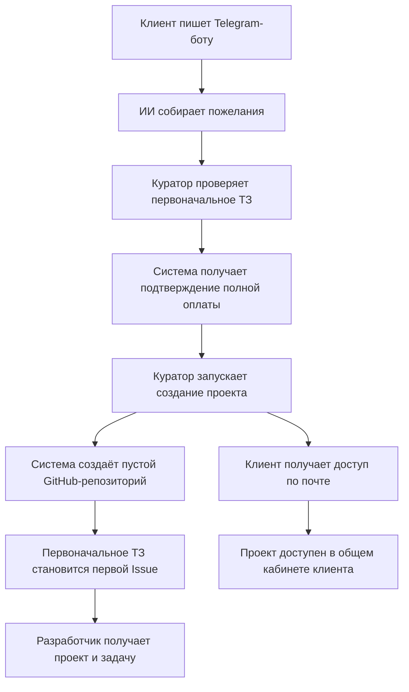

# Личные кабинеты NODO Studio: требования к первой версии

Документ собирает решения из обсуждения продукта. Первая реализация интерфейсов четырёх ролей доступна в `/cabinet-demo/`; сервер авторизации, чатов, задач и адаптеры внешних сервисов находятся в `server/`. Реальные подключения и запуск API на домене требуют настройки. Платежи остаются тестовыми. Инструкции и ограничения — в [руководстве по запуску кабинета](portal-setup.md).

## Назначение

Клиент следит за разработкой своих проектов и передаёт пожелания через ИИ. ИИ собирает требования, помогает разобраться в переписке и готовит задачи. Основную разработку выполняет разработчик.

Поддерживаются новые проекты студии. Один клиент использует один кабинет для нескольких проектов; у каждого проекта собственные чат, этапы, задачи и история коммитов.

## Согласованные роли

| Роль | Возможности первой версии |
| --- | --- |
| Клиент | Вход по почте, просмотр своих проектов, этапов, GitHub Issues и истории коммитов; общение и описание пожеланий в существующем чате проекта; подтверждение подготовленных ИИ задач; получение цены пожелания и оплата |
| Разработчик | Один общий аккаунт и кабинет со всеми проектами и заявками; просмотр оплаченного ТЗ и проверка новых пожеланий на соответствие ему; назначение базовой цены реализации пожеланий; управление этапами и задачами; подключение к чату проекта |
| Куратор / техподдержка | Общая очередь Telegram-диалогов; просмотр переписки и подключение к ней; помощь с доступом и использованием кабинета, вопросами оплаты; работа с почтой и username клиента; первоначальная подготовка и создание проектов после оплаты. Этапы, задачи и чат разработки относятся к зоне разработчика |
| Админ | Отдельная роль с пустой страницей; функции будут определены позже |

Клиент получает доступ к кабинету после полной оплаты проекта. Оплата основной работы и дополнительных пожеланий подтверждается автоматически платёжным сервисом. Прямой доступ клиента к GitHub не предусмотрен в первой версии.

У ролей отдельные зоны ответственности. Куратор выполняет функции техподдержки и первоначальной подготовки клиента. После создания проекта он остаётся доступен через Telegram по вопросам доступа, работы кабинета и оплаты. Доступ к этапам, задачам и чату разработки ему не предоставляется. Поддержке достаточно ограниченной карточки состояния платежа; менять факт оплаты вручную куратор не должен.

## Каналы общения

### Telegram: клиент, ИИ и куратор

Точка входа, указанная владельцем: [@node_studio_bot](https://t.me/node_studio_bot). Подключение бота и доставка сообщений ещё не проверены.

1. Клиент пишет боту студии.
2. ИИ начинает разговор, собирает пожелания и помогает их сформулировать.
3. Кураторы видят общую очередь и всю переписку с клиентом.
4. Куратор может подключиться к диалогу.
5. После получения доступа к кабинету клиент обращается к куратору как к техподдержке через того же Telegram-бота.

ИИ собирает пожелания и помогает разобраться по проекту. Стоимость, сроки и условия не определяются ИИ.

### Кабинет: клиент, ИИ и разработчик

1. Клиент выбирает проект и открывает его чат.
2. ИИ использует переписку этого проекта и помогает подготовить пожелание к передаче разработчику.
3. Клиент просматривает подготовленный текст задачи и подтверждает отправку.
4. Система создаёт задачу в GitHub Issues соответствующего репозитория.
5. Задача появляется в кабинете клиента и в общей очереди разработчика.
6. Для оплачиваемого пожелания разработчик назначает базовую цену; система рассчитывает цену клиенту с наценкой 30%.
7. Клиент оплачивает согласованное пожелание; система автоматически получает подтверждение платёжного сервиса.
8. После подтверждения оплаты разработчик может приступить к реализации пожелания.

Клиент описывает пожелания в существующем чате проекта. Отдельный раздел, кнопка входа в раздел пожеланий или дополнительный чат с куратором для этого не создаются.

У разработчика есть кнопки «Подключиться к диалогу» и «Покинуть диалог». Пока разработчик подключён, диалог ведёт он. После нажатия «Покинуть диалог» управление автоматически возвращается ИИ. Закрытие вкладки не заменяет это действие.

Контекст ИИ ограничен перепиской. Переписки разных проектов разделены. В первой версии поддерживается только текст; обработка вложений, изображений, документов, голоса и видео отложена.

### Оценка и оплата пожеланий

Правило наценки применяется только к дополнительным пожеланиям. Разработчик назначает базовую стоимость реализации пожелания. Система прибавляет к ней 30%; клиент оплачивает полученную итоговую сумму. На основную разработку проекта это правило не распространяется.

```text
Цена клиенту = цена разработчика × 1,30
Наценка = цена разработчика × 0,30
```

Страна приёма платежей — РФ, валюта — российские рубли (`RUB`). Пример: при базовой цене 10 000 ₽ итоговая цена клиенту составляет 13 000 ₽, наценка — 3 000 ₽. Это прибавление 30% к базовой цене.

ИИ собирает требования; решение о базовой цене принимает разработчик. Клиент получает возможность оплатить выставленную сумму; система автоматически подтверждает успешную оплату через платёжный сервис. Куратор помогает разобраться с проблемой оплаты в роли техподдержки.

Создание Issue передаёт пожелание на рассмотрение и оценку; это действие не подтверждает оплату. Подтверждение формулировки задачи клиентом и подтверждение её оплаты — разные события. Разработчик видит, подтверждена ли оплата, до начала реализации.

В заглушке суммы хранятся целым числом копеек; наценка округляется до ближайшей копейки. Порядок реальных выплат и отображение составляющих цены требуют отдельного решения на этапе интеграции.

### Автоматическое подтверждение оплаты

Автоматическое подтверждение требуется для основной работы и дополнительных пожеланий. Платёжного сервиса пока нет. На текущем этапе используется тестовая заглушка; подключение реальных платежей отложено.

Система связывает платёж с конкретным заказом или пожеланием. Доступ к кабинету, разрешение создать репозиторий и готовность оплачиваемого пожелания к реализации зависят от подтверждённой оплаты соответствующей позиции. Источником факта оплаты служит платёжный сервис.

Технический способ подтверждения — серверное уведомление и/или проверка состояния через API выбранного сервиса — определяется по его документации. Возврат браузера на страницу успешной оплаты сам по себе не подтверждает получение денег. Повторное подтверждение одного платежа не должно повторно создавать проект, аккаунт, задачу или выдавать доступ.

### Реализованная тестовая заглушка

Страница проверки — `/payment-demo/`. На ней есть карточка оплаты, светлая и тёмная темы, раскрытие подробностей и тестовое окно с выбором результата: успех, ошибка или отмена. После ошибки доступен повтор; при отмене обработка прерывается. Изменение оценки создаёт новую тестовую сессию.

В «Параметрах теста» можно изменить базовую цену и переключить оплату пожелания на основной проект: у пожелания добавляется 30%, у основной работы наценки нет. Это инструменты демонстрации, а не интерфейс доступа клиента к цене разработчика. Правило видимости разбивки реальной цены ещё не выбрано.

Компонент `MockPaymentCard` находится в `src/features/payments/components` и подготовлен для дальнейшего размещения в чате. Расчёт суммы и имитация обработки вынесены из компонента в отдельные модули.

Заглушка работает только в памяти страницы, помечена тестовым режимом и возвращает результат с `provider: "mock"`. Она не списывает деньги, не создаёт записи о реальной оплате, не меняет доступ к проектам и не вызывает GitHub. При обновлении страницы её состояние сбрасывается. Демонстрация закрыта от индексации и не включена в sitemap.

### Просьба подключить человека

При первом общении ИИ объясняет клиенту, что по его просьбе можно позвать человека. Клиент формулирует просьбу обычным сообщением. В Telegram она адресуется куратору, в чате разработки — разработчику.

Примеры первого объяснения:

- В Telegram: «Я помогу собрать пожелания по проекту. Если захотите поговорить с куратором, просто попросите — я его позову».
- В чате разработки: «Я помогу сформулировать задачу. Если потребуется разработчик, попросите меня его позвать».

Примеры задают смысл; окончательные тексты будут оформлены вместе с интерфейсом. Возможность объясняется при начале общения, а не в каждом сообщении.

Просьба регистрируется как запрос на подключение человека. Само подключение происходит, когда сотрудник принимает диалог; до этого клиент видит, что запрос ожидает ответа. После подключения человека ИИ уступает ему управление. Разработчик возвращает управление ИИ кнопкой «Покинуть диалог».

## От первого обращения до проекта



Куратор указывает почту и Telegram username клиента. После подтверждения оплаты становится доступно создание репозитория в GitHub-аккаунте `Matthew-zzz`.

Для нового клиента система создаёт учётную запись и отправляет доступ на почту. Почта используется как логин. При первом входе клиент меняет временный пароль. Следующие проекты привязываются к этому же аккаунту.

Первоначальное ТЗ собирается из Telegram-переписки, проверяется куратором и после создания репозитория становится первой GitHub Issue. Для нового проекта используется согласованное ТЗ, а не переписки клиента по другим проектам.

Разработчик видит, какое ТЗ оплатил клиент, и самостоятельно проверяет новые пожелания на соответствие этому объёму. Последующие пожелания оформляются отдельными задачами, сохраняя возможность сравнить их с первоначальным согласованным ТЗ. ИИ собирает пожелания; решение о соответствии оплаченному объёму принимает разработчик.

## GitHub как источник правды

Данные о работе над проектом берутся из GitHub. Кабинет отражает изменения, выполненные как через интерфейс системы, так и непосредственно на GitHub.

| Данные | Правило |
| --- | --- |
| Репозиторий проекта | Создаётся системой после подтверждения оплаты; исходно пустой |
| Первоначальное ТЗ | Первая GitHub Issue; разработчик использует согласованный оплаченный объём для проверки новых пожеланий |
| Подтверждённые пожелания | GitHub Issues своего проекта; создаются после подтверждения клиентом текста задачи, затем поступают разработчику на рассмотрение и оценку |
| Состояния задач | Читаются из GitHub; изменения из кабинета записываются в GitHub |
| Этапы | Название, описание, статус; заполняет разработчик. Предлагается хранить их в GitHub; формат требует отдельного решения |
| История работ | Полная история коммитов, включая первый; краткое описание выполненного берётся из заголовков коммитов |

Пользователи, доступ к проектам, подтверждение оплаты и переписка — собственные данные приложения. Местная копия задач и истории может служить кэшем, но не заменяет GitHub как источник состояния проекта.

У пустого репозитория история коммитов пуста до первого настоящего коммита. Создание репозитория или Issue не должно отображаться как вымышленный коммит. Откат кода отложен.

В интерфейсе клиент видит разрешённые данные своего проекта без необходимости входить в GitHub.

## Экраны первой версии

| Область | Экраны и содержимое |
| --- | --- |
| Вход | Почта и пароль; обязательная смена временного пароля |
| Клиент: проекты | Список собственных проектов и переход к выбранному |
| Клиент: проект | Этапы, задачи, история коммитов и существующий чат проекта, в котором клиент описывает пожелания |
| Клиент: задача | Краткое представление, раскрытие полного текста и текущий статус из GitHub |
| Оценка пожелания в чате | Разработчик назначает базовую цену; система рассчитывает итоговую сумму клиенту с наценкой 30%; клиент оплачивает, статус оплаты обновляется автоматически |
| Разработчик | Общая очередь задач, проекты, изменение этапов и задач, оценка стоимости реализации, чаты проектов |
| Куратор: диалоги | Общая очередь Telegram-переписок, первоначальное сопровождение и техподдержка, подключение к диалогу |
| Куратор: проекты | Почта и username клиента, проверка первоначального ТЗ, просмотр автоматически полученного состояния оплаты, запуск создания проекта; без доступа к задачам, этапам и чату разработки |
| Админ | Пустая страница |

Уведомления о новых задачах, сообщениях и смене этапов отложены. Письмо с доступом к кабинету остаётся частью первого входа.

## Визуальное направление

Согласованы светлая и тёмная темы с переключателем. Интерфейс спокойный, лаконичный, с небольшим количеством информации на экране. Цель — снизить зрительную нагрузку во время работы.

- В карточках показываются короткие названия, статусы и необходимые действия.
- Длинные описания, тексты задач и подробности открываются по явной кнопке.
- Раскрытие сохраняет доступ к полному тексту; содержание не теряется из-за краткого представления.
- Цвет используется умеренно: для действий, состояния и выбранного элемента.
- Для клиента основной фокус — выбранный проект и его чат; для разработчика — очередь задач; для куратора — очередь диалогов.

## Предлагаемые решения для реализации

Это предложения, а не дополнительные согласованные функции.

1. Сохранять выбранную тему; до первого выбора учитывать системную тему. Обеспечить контраст, видимый фокус и управление раскрытием с клавиатуры.
2. Показывать длинные тексты в раскрывающемся блоке или панели подробностей. На мобильном экране сохранять доступ к навигации и возврату в список.
3. Использовать состояния этапов «Не начат», «В работе», «Завершён» и задач «Новая», «В работе», «Выполнена», сохраняя корректное отображение изменений из GitHub.
4. Хранить этапы как отдельные размеченные Issues в том же репозитории. Подтверждённые пожелания и первоначальное ТЗ отделять по типу записи. Точную схему меток и соответствие состояниям GitHub определить до реализации.
5. Получать изменения GitHub через вебхуки и сверять состояние через API. Подтверждать сохранение пользователю после успешной записи в GitHub. Повторная доставка события или повторное нажатие кнопки не должны создавать дубликаты репозиториев и задач. Возможности событий описаны в [GitHub Webhooks](https://docs.github.com/en/webhooks/webhook-events-and-payloads), операции с задачами — в [GitHub Issues API](https://docs.github.com/en/rest/issues/issues).
6. При передаче чата человеку останавливать автоматические ответы ИИ, включая уже запущенную генерацию. Показывать участникам, кто сейчас ведёт диалог. Для общей очереди кураторов требуется правило одновременного подключения.
7. Хранить технический Telegram ID вместе с username и почтой, связывая новые сообщения с тем же клиентом. Формат входящих сообщений определён в [Telegram Bot API](https://core.telegram.org/bots/api#update).
8. Создавать приватные репозитории в аккаунте владельца. Сервер выполняет операции GitHub; браузер клиента получает только данные, разрешённые для его проектов.
9. Показывать просьбу подключить человека отметкой в соответствующей очереди диалогов. Это состояние самой очереди; отдельные почтовые и push-уведомления отложены.
10. Применять границы ролей на сервере при выдаче данных и выполнении действий. Куратор не должен получать содержимое чата разработки, задачи и этапы через API.
11. Показывать оценку и состояние оплаты компактной карточкой в существующем чате проекта. Полное описание задачи открывать по кнопке; отдельный раздел пожеланий не добавлять.
12. Для разбора вопросов оплаты показывать техподдержке клиента, проект, идентификатор заказа или пожелания, сумму и состояние платежа. Полная задача, этапы и переписка разработки для этого не требуются. Состояние оплаты поступает от платёжного сервиса.
13. Подтверждать платёж на сервере с проверкой принадлежности заказу, суммы, валюты и успешного состояния по правилам выбранного сервиса. Неуспешный или отменённый платёж не открывает доступ и не разрешает начать оплачиваемую работу.

Сайт сохраняет статический экспорт Next.js. Кабинет использует отдельный Node.js 24 API и SQLite вне каталога сайта. Nginx передаёт `/api/portal/` серверу; остальная публикация работает по прежней схеме. Демонстрация использует изолированное браузерное хранилище и сценарные ответы, без вызовов реальных сервисов.

## Детали для следующего этапа проектирования

Основная схема пожеланий согласована: существующий чат проекта, оценка разработчика, наценка 30% только на пожелания и автоматическое подтверждение оплаты. Куратор остаётся техподдержкой и помогает на начальном этапе. Страна — РФ, валюта — рубли. На текущем этапе реализована заглушка оплаты; для реальных платежей позднее нужно выбрать сервис, определить видимость разбивки цены, обработку изменения согласованного объёма и доступ к интеграциям.

## Критерии приёмки будущей реализации

- Клиент входит по почте, меняет временный пароль и видит только свои проекты.
- Несколько проектов доступны из одного аккаунта; у каждого своя переписка и задачи.
- Кураторы видят общую очередь сообщений из указанного Telegram-бота.
- Куратор сопровождает клиента на начальном этапе и остаётся техподдержкой через Telegram; этапы, задачи и чат разработки ему недоступны.
- Репозиторий создаётся после автоматического подтверждения оплаты основной работы; повторное действие не создаёт второй проект или аккаунт.
- Проверенное первоначальное ТЗ становится первой Issue и появляется в очереди разработчика.
- Клиент описывает пожелание в существующем чате проекта и подтверждает текст подготовленной ИИ задачи; до подтверждения она остаётся черновиком в чате. После подтверждения создаётся GitHub Issue для рассмотрения разработчиком.
- Разработчик видит согласованное оплаченное ТЗ и проверяет, входят ли новые пожелания в этот объём.
- Базовую цену реализации пожелания назначает разработчик; итоговая сумма клиенту рассчитывается с наценкой 30% к этой цене. Например, 10 000 превращаются в 13 000. Правило не применяется к основной работе проекта.
- Оплата пожелания подтверждается автоматически платёжным сервисом; разработчик видит подтверждение до начала реализации. Пожелания обсуждаются в существующем чате проекта.
- Переход клиента на страницу успешной оплаты не заменяет серверное подтверждение. Неуспешная оплата не открывает доступ; повторное событие платежа не дублирует проект или задачу.
- Изменения задач на GitHub отражаются в кабинете; изменения из кабинета сохраняются в GitHub.
- Отображаются реальные коммиты, включая первый; пустая история имеет отдельное состояние.
- Разработчик может принять чат и явно покинуть его; ИИ возвращается после выхода человека.
- При первом общении ИИ объясняет возможность позвать человека. Просьба клиента создаёт запрос куратору в Telegram или разработчику в чате проекта.
- Работают светлая и тёмная темы, раскрытие подробностей и мобильная версия интерфейса.

Эти пункты описывают ожидаемое поведение подключённой системы. Серверные права, основные операции и сценарии деморежима проверяются тестами. До подключения аккаунтов GitHub, Telegram, ИИ и почты внешние операции не считаются проверенными на реальных сервисах. Реальный платёжный провайдер ещё не выбран.
